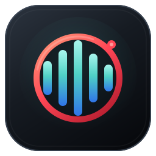
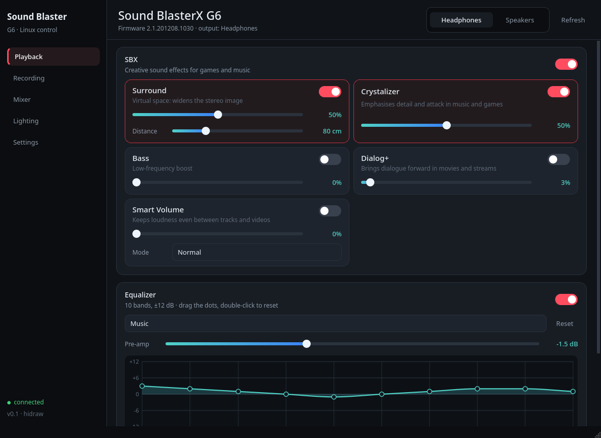

<p align="center"></p>

# Sound Blaster G6 for Linux

[Русский](README.md) · **English**

A full replacement for **Sound Blaster Command** for the **Creative Sound
BlasterX G6** USB DAC/amp (`041e:3256`, SB1770 board): SBX effects, a 10-band
equalizer, Scout Mode, Direct Mode, microphone processing, mixer, DAC filter and
RGB lighting.

Everything is programmed into the DSP of the device itself over the vendor HID
protocol, so the effects apply to every game and player — no PipeWire/EasyEffects
chain involved.



Tested on **Arch Linux** (kernel 7.3.4-zen, PipeWire 1.x, KDE Plasma/Wayland)
with G6 firmware `2.1.201208.1030`. Should work on any distribution with PySide6
and ALSA.

## Features

| Section | What you get |
|---|---|
| **SBX** | Master switch; Surround (+ 10–300 cm distance), Crystalizer, Bass, Dialog+, Smart Volume (Normal/Loud/Night) with levels |
| **Equalizer** | 10 bands ±12 dB, pre-amp ±6 dB, interactive curve (drag dots, double-click to reset, wheel for 0.5 dB steps), 8 presets |
| **Scout Mode** | On/off, mutually exclusive with SBX |
| **Recording** | Voice Clarity (noise reduction) with level, echo cancellation, Smart Volume, mic boost 0/10/20/30 dB, microphone EQ (11 presets from Windows) |
| **Mixer** | Volume and mute for Speaker, Line In, External Mic, S/PDIF In (monitoring) and capture inputs, recording source selector (Line In / External Mic / S/PDIF / What U Hear) |
| **Lighting** | Ring on/off, one-click preset colours, separate palette for a custom colour |
| **Settings** | Headphones/Speakers output, Direct Mode, CS43131 DAC filter (5 options), profiles, tray autostart, state restore, interface language |
| **Languages** | Русский, English, Deutsch, Français, Español, Português (BR), 简体中文 — switchable in settings, applied instantly |
| **Profiles** | Unlimited sets of settings, switching from the window or the tray, restore of the last state on login |
| **Tray** | Output, SBX, Scout, equalizer, profiles |
| **CLI** | Everything from a terminal: `g6 status`, `g6 eq --preset gaming`, `g6 output speakers`, `g6 profile load …` |

## Installation

### Arch Linux / running from source

```bash
git clone https://github.com/SergeyVN94/sbg6.git
cd sbg6
./install.sh
```

The script installs the udev rule `packaging/70-sbg6.rules` (the user on the
current seat gets access; no groups or re-login needed), a launcher, an icon and
a systemd user unit for restoring the profile.

### Debian / Ubuntu (.deb)

Download `sbg6_0.1.1_all.deb` from [Releases](https://github.com/SergeyVN94/sbg6/releases)
and run:

```bash
sudo apt install ./sbg6_0.1.1_all.deb
```

Requirements: `python3-pyside6.qtwidgets`, `libasound2`. The package installs the
udev rule; optionally enable profile restore:

```bash
systemctl --user enable --now sbg6-restore.service
```

### AppImage (any distribution)

```bash
chmod +x sbg6-0.1.1-x86_64.AppImage
./sbg6-0.1.1-x86_64.AppImage
```

The AppImage bundles Python and PySide6. Install the udev rule once:

```bash
./sbg6-0.1.1-x86_64.AppImage setup
```

(`pkexec` or `sudo` is used), then replug the G6. On systems without FUSE, run it
with `--appimage-extract-and-run`.

### Check

```bash
g6 info     # firmware, serial, connection
g6 status   # every current setting
```

If `g6 info` reports “No access to /dev/hidrawN”, the udev rule is not active:
run `g6 setup` and replug the device.

## Running

```bash
g6 gui                 # window
g6 gui --tray          # start hidden in the tray (used by autostart)
g6 gui --device /dev/hidraw7   # if autodetection fails
```

The **Sound Blaster G6** launcher appears in the application menu. Closing the
window hides it to the tray; use the tray menu or `Ctrl+Q` to quit.

## CLI

```bash
g6 status [--json]              # full state, machine-readable with --json
g6 info                         # device and firmware
g6 setup                        # install the udev rule
g6 autostart on|off|status      # start the app on login
g6 sbx on|off                   # SBX master switch
g6 scout on|off                 # Scout Mode
g6 direct on|off                # Direct Mode (USB re-enumerates, ~2 s)
g6 output headphones|speakers|toggle

g6 eq --on --preset gaming      # preset + enable
g6 eq --preamp -3 --on          # pre-amp only
g6 eq 4 3 1 -1 -2 -1 1 3 4 3    # 10 bands, dB
g6 eq 1k=+3 4k=-2 --on          # per-frequency tweaks
g6 eq --off

g6 mic-boost 10                 # 0 / 10 / 20 / 30 dB
g6 dac-filter 4                 # 1…5
g6 lighting on|off
g6 lighting color "#ff3030"

g6 profile save gaming          # save the current state
g6 profile list
g6 profile load gaming
g6 profile delete gaming

g6 get 96:07                    # read a register (family:feature)
g6 set 96:07 1                  # write a register
g6 dump                         # snapshot of known registers (debug)
g6 raw "5a 26 03 08 ff ff"      # send an arbitrary frame (debug)
```

### Autostart and restore on login

Settings has two independent options:

* **Start the app when logging in** — writes `~/.config/autostart/sbg6.desktop`
  and starts the window hidden in the tray (`g6 gui --tray`). For the AppImage the
  entry points at the AppImage file itself; for the deb/source tree it points at
  the `g6` launcher.
* **Restore the last state when logging in** — enables the
  `sbg6-restore.service` systemd unit, which runs `g6 restore --wait 45`, waits
  for the G6 and applies the last state. No window is required.

From a terminal:

```bash
g6 autostart on|off|status
systemctl --user enable sbg6-restore.service
```

## How it works

* **HID interface 4.** Settings are 64-byte frames `5a CMD LEN payload` sent to
  `/dev/hidrawN`. We deliberately use hidraw so the kernel keeps the interrupt
  endpoint polled; libusb would require a USB reset that interrupts audio. See
  [docs/protocol.md](docs/protocol.md) for the command reference.
* **The mixer is USB Audio Class.** Input/output volumes are not HID commands;
  the app talks to them through the ALSA mixer API (`libasound`, ctypes) — the
  same `SET_CUR` requests Windows sends.
* **Processing happens in hardware.** SBX and the equalizer run on the G6 DSP, so
  there is no added latency and the settings apply to all applications at once.

## Limitations

* **Direct Mode** re-clocks the USB link: the device re-enumerates for a couple of
  seconds and audio drops. The app reconnects automatically; this is expected.
* **Lighting** supports a static colour and on/off only; the G6 firmware has no
  breathing or pulsing effects.
* **Microphone EQ** is written as 8 bands, but Creative does not document their
  frequencies; Windows only exposes presets, which is what the UI offers.
* **Sample rate and bit depth** are not device settings: the format is chosen by
  PipeWire or the application when it opens the stream.
* Headphones/speakers share one PipeWire volume; switching the output only changes
  the physical output on the board.

## Troubleshooting

| Symptom | Fix |
|---|---|
| `Permission denied` on hidraw | `g6 setup`, replug the G6, check `getfacl /dev/hidraw*` |
| Device not found | `lsusb \| grep 041e`, `g6 -d /dev/hidrawN info` |
| `Protocol error` on write | The device re-enumerated (Direct Mode/USB glitch); the app reconnects, rerun the CLI command |
| No sound after Direct Mode | Wait 2–3 s for PipeWire to recreate the sink; if needed `systemctl --user restart wireplumber` |
| Settings reset | The G6 keeps its own last state; apply a profile after a firmware update or reset |

## Building packages

```bash
./packaging/build_deb.sh        # build/dist/sbg6_<version>_all.deb (needs ar, tar, xz)
./packaging/build_appimage.sh   # build/dist/sbg6-<version>-x86_64.AppImage
```

The AppImage build needs PyInstaller (visible to an interpreter with PySide6) and
`rsvg-convert`; `appimagetool` is downloaded automatically.

## Layout

```
bin/g6                  launcher (system Python)
g6app/device.py         HID transport and commands
g6app/features.py       register map, ranges, presets
g6app/state.py          state model, profiles, Controller
g6app/mixer.py          ALSA mixer via ctypes
g6app/i18n.py           interface translations
g6app/cli.py            command line interface
g6app/gui/              PySide6: theme, widgets, pages, window and tray
packaging/              udev rule, deb/AppImage builds
systemd/                profile restore unit
tools/check_i18n.py     translation completeness check
```

## License

MIT. Sound Blaster and Creative are trademarks of Creative Technology Ltd.;
this project is not affiliated with Creative. The protocol was reverse-engineered
by the community (`linuxblaster_control`, `soundblaster-x-g6-cli`) and verified on
hardware.
