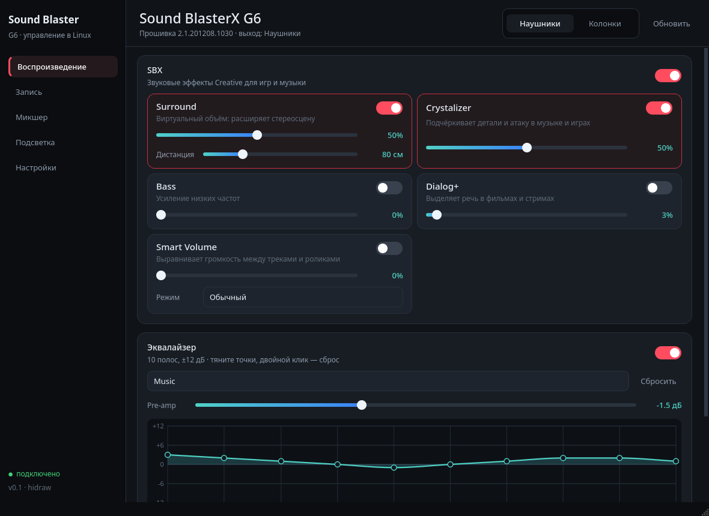

# Sound Blaster G6 для Linux

**Русский** · [English](README.en.md)

Полноценная замена **Sound Blaster Command** для USB-ЦАП/усилителя **Creative
Sound BlasterX G6** (`041e:3256`, плата SB1770): SBX-эффекты, 10-полосный
эквалайзер, Scout Mode, Direct Mode, микрофон, микшер, ЦАП-фильтр и подсветка.

Все настройки уходят в DSP самого устройства по вендорному HID-протоколу,
поэтому эффекты работают в любой игре и любом плеере — PipeWire/EasyEffects для
этого не нужны.



Протестировано на **Arch Linux** (kernel 7.3.4-zen, PipeWire 1.x, KDE Plasma /
Wayland) с прошивкой G6 `2.1.201208.1030`. Должно работать на любом дистрибутиве
с PySide6 и ALSA.

## Что умеет

| Раздел | Возможности |
|---|---|
| **SBX** | Общий выключатель SBX; Surround (+ дистанция 10–300 см), Crystalizer, Bass, Dialog+, Smart Volume (Normal/Loud/Night) — с уровнями |
| **Эквалайзер** | 10 полос ±12 дБ, pre-amp ±6 дБ, интерактивная кривая (тяните точки, двойной клик — сброс, колесо — шаг 0,5 дБ), 8 пресетов |
| **Scout Mode** | Включение/выключение, взаимоисключающе с SBX |
| **Запись** | Voice Clarity (шумоподавление) с уровнем, эхоподавление, Smart Volume, усиление микрофона 0/10/20/30 дБ, микрофонный эквалайзер (11 пресетов из Windows) |
| **Микшер** | Громкость и mute для Speaker, Line In, External Mic, S/PDIF In (мониторинг) и для входов записи, выбор источника записи (Line In / External Mic / S/PDIF / What U Hear) |
| **Подсветка** | Включение кольца, готовые цвета в один клик, отдельная палитра для своего цвета |
| **Настройки** | Выход «Наушники/Колонки», Direct Mode, цифровой фильтр ЦАП CS43131 (5 вариантов), профили, автовосстановление при входе, выбор языка |
| **Языки** | Русский, English, Deutsch, Français, Español, Português (BR), 简体中文 — переключаются в настройках и применяются сразу |
| **Профили** | Неограниченное число наборов настроек, переключение из окна и из трея, восстановление последнего состояния при логине |
| **Трей** | Выход, SBX, Scout, эквалайзер, профили |
| **CLI** | Всё то же из терминала: `g6 status`, `g6 eq --preset gaming`, `g6 output speakers`, `g6 profile load …` |

## Установка

### Arch Linux и запуск из исходников

```bash
git clone https://github.com/SergeyVN94/sbg6.git
cd sbg6
./install.sh
```

Скрипт ставит правило udev `packaging/70-sbg6.rules` (доступ к HID получает
пользователь, сидящий за компьютером, — группы и перелогин не нужны), ярлык,
иконку и systemd-юнит восстановления профиля.

### Debian / Ubuntu (пакет .deb)

Скачайте `sbg6_0.1.0_all.deb` со страницы [Releases](https://github.com/SergeyVN94/sbg6/releases)
и выполните:

```bash
sudo apt install ./sbg6_0.1.0_all.deb
```

Зависимости: `python3-pyside6.qtwidgets`, `libasound2`. Правило udev ставится
пакетом; при желании включите восстановление профиля:

```bash
systemctl --user enable --now sbg6-restore.service
```

### AppImage (любой дистрибутив)

```bash
chmod +x sbg6-0.1.0-x86_64.AppImage
./sbg6-0.1.0-x86_64.AppImage
```

AppImage несёт свой Python и PySide6. Правило udev нужно установить один раз:

```bash
./sbg6-0.1.0-x86_64.AppImage setup
```

(используется `pkexec` или `sudo`), после чего переподключите G6. На системах без
FUSE запускайте через `--appimage-extract-and-run`.

### Проверка

```bash
g6 info     # прошивка, серийник, связь
g6 status   # текущее состояние всех параметров
```

Если `g6 info` пишет «Нет доступа к /dev/hidrawN» — правило udev не применилось:
`g6 setup`, затем переподключите устройство.

## Запуск

```bash
g6 gui                 # окно
g6 gui --device /dev/hidraw7   # если автопоиск не сработал
```

Ярлык **Sound Blaster G6** появляется в меню приложений. Закрытие окна сворачивает
приложение в трей, полный выход — через меню трея или `Ctrl+Q`.

## CLI

```bash
g6 status [--json]              # всё состояние, в т.ч. машиночитаемо
g6 info                         # устройство и прошивка
g6 setup                        # установить правило udev
g6 sbx on|off                   # мастер-выключатель SBX
g6 scout on|off                 # Scout Mode
g6 direct on|off                # Direct Mode (USB переподключается, ~2 с)
g6 output headphones|speakers|toggle

g6 eq --on --preset gaming      # пресет + включение
g6 eq --preamp -3 --on          # только pre-amp
g6 eq 4 3 1 -1 -2 -1 1 3 4 3    # 10 полос, дБ
g6 eq 1k=+3 4k=-2 --on          # точечно по частотам
g6 eq --off

g6 mic-boost 10                 # 0 / 10 / 20 / 30 дБ
g6 dac-filter 4                 # 1…5
g6 lighting on|off
g6 lighting color "#ff3030"

g6 profile save gaming          # сохранить текущее состояние
g6 profile list
g6 profile load gaming
g6 profile delete gaming

g6 get 96:07                    # прочитать регистр (family:feature)
g6 set 96:07 1                  # записать
g6 dump                         # срез всех известных регистров (отладка)
g6 raw "5a 26 03 08 ff ff"      # произвольный кадр (отладка)
```

### Автовосстановление при входе

```bash
systemctl --user enable sbg6-restore.service
```

Юнит вызывает `g6 restore --wait 45`: ждёт появления G6 и применяет последнее
состояние, сохранённое окном. То же можно включить галочкой в «Настройках».

## Как это работает

* **HID, интерфейс 4.** Настройки — 64-байтные кадры `5a CMD LEN payload` через
  `/dev/hidrawN`. Работа идёт именно через hidraw, чтобы ядро продолжало
  опрашивать interrupt endpoint: libusb потребовал бы USB-reset, который
  обрывает звук. Подробности и таблица команд — в [docs/protocol.md](docs/protocol.md).
* **Микшер — это USB Audio Class.** Громкости входов/выходов не являются
  HID-командами; приложение говорит с ними через ALSA mixer API (`libasound`,
  ctypes), то есть теми же `SET_CUR`, что и Windows.
* **Обработка в железе.** SBX и эквалайзер считает DSP G6, поэтому задержки и
  обхода PipeWire нет, а настройки действуют на все приложения сразу.

## Ограничения

* **Direct Mode** перестраивает тактирование USB: устройство на пару секунд
  переподключается, звук прерывается. Приложение переподключается само,
  но это ожидаемое поведение, а не сбой.
* **Подсветка** — только статический цвет и вкл/выкл: прошивка G6 не умеет
  «дыхание» и пульсацию.
* **Микрофонный эквалайзер** записывается 8 полосами, но их частоты Creative не
  документирует; в Windows доступны только пресеты — они и вынесены в интерфейс.
* **Частота дискретизации и разрядность** не являются настройкой устройства:
  формат выбирает PipeWire/приложение при открытии потока.
* Громкость «Наушники/Колонки» в PipeWire общая — переключение выхода меняет
  только физический выход платы.

## Диагностика

| Симптом | Что делать |
|---|---|
| `Permission denied` на hidraw | `g6 setup`, переподключить G6, `getfacl /dev/hidraw*` |
| Устройство не найдено | `lsusb \| grep 041e`, `g6 -d /dev/hidrawN info` |
| `Protocol error` при записи | Устройство переподключилось (Direct Mode/сбой USB) — приложение переподключится; для CLI повторите команду |
| Нет звука после Direct Mode | Подождите 2–3 с, пока PipeWire пересоздаст sink; при необходимости `systemctl --user restart wireplumber` |
| Настройки сбросились | G6 хранит последнее состояние в себе; после смены прошивки/сброса примените профиль |

## Сборка пакетов

```bash
./packaging/build_deb.sh        # build/dist/sbg6_<version>_all.deb (нужны ar, tar, xz)
./packaging/build_appimage.sh   # build/dist/sbg6-<version>-x86_64.AppImage
```

Для AppImage нужны PyInstaller (видимый интерпретатору с PySide6),
`rsvg-convert`; `appimagetool` скачивается автоматически.

## Структура

```
bin/g6                  лаунчер (системный Python)
g6app/device.py         HID-транспорт и команды
g6app/features.py       карта регистров, диапазоны, пресеты
g6app/state.py          модель состояния, профили, Controller
g6app/mixer.py          ALSA mixer через ctypes
g6app/i18n.py           переводы интерфейса
g6app/cli.py            командная строка
g6app/gui/              PySide6: тема, виджеты, страницы, окно и трей
packaging/              udev, сборка deb/AppImage
systemd/                юнит восстановления профиля
tools/check_i18n.py     проверка полноты переводов
```

## Лицензия

MIT. Sound Blaster и Creative — товарные знаки Creative Technology Ltd.;
проект не связан с Creative. Протокол собран сообществом (проекты
`linuxblaster_control`, `soundblaster-x-g6-cli`) и перепроверен на устройстве.
